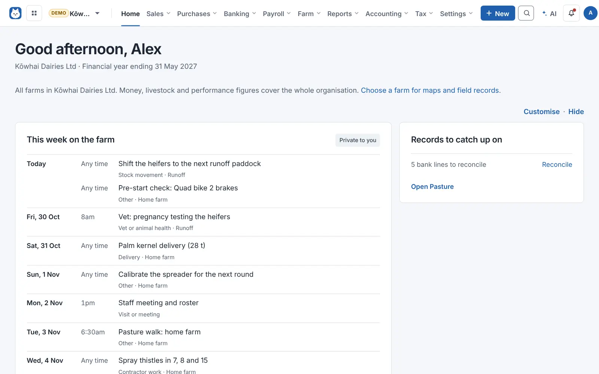
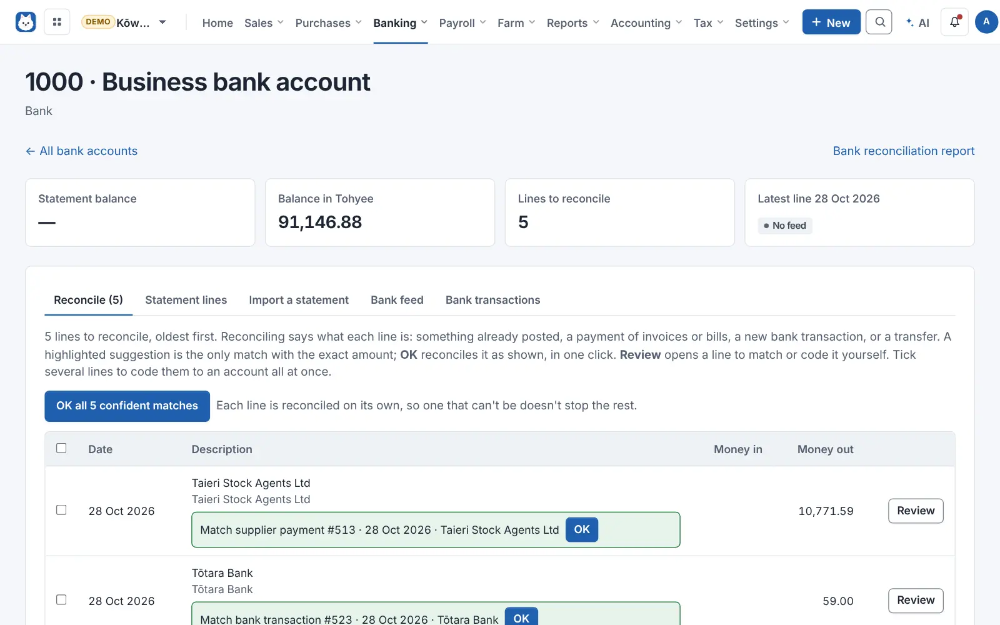
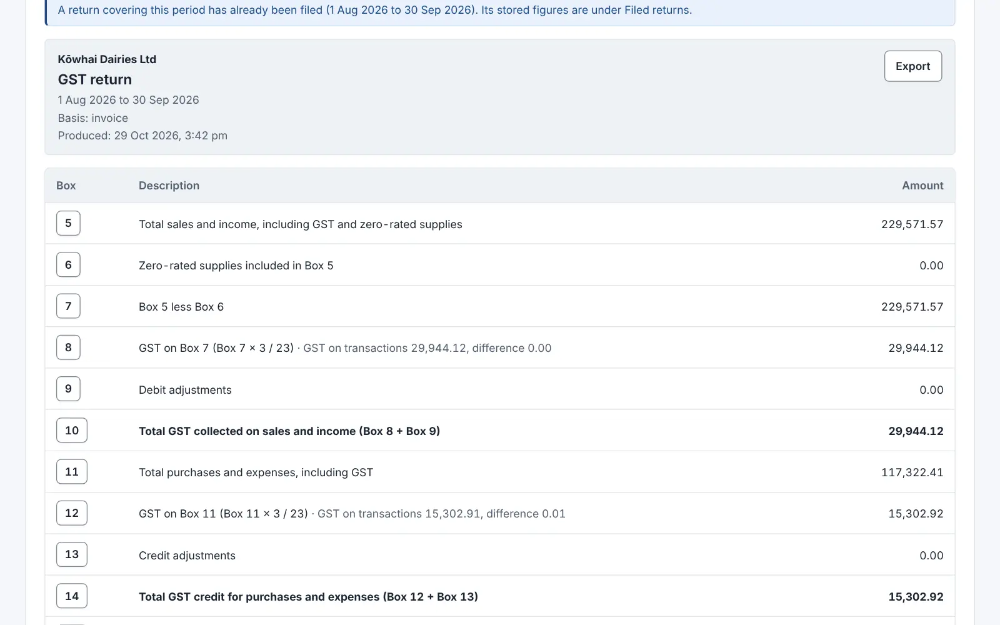
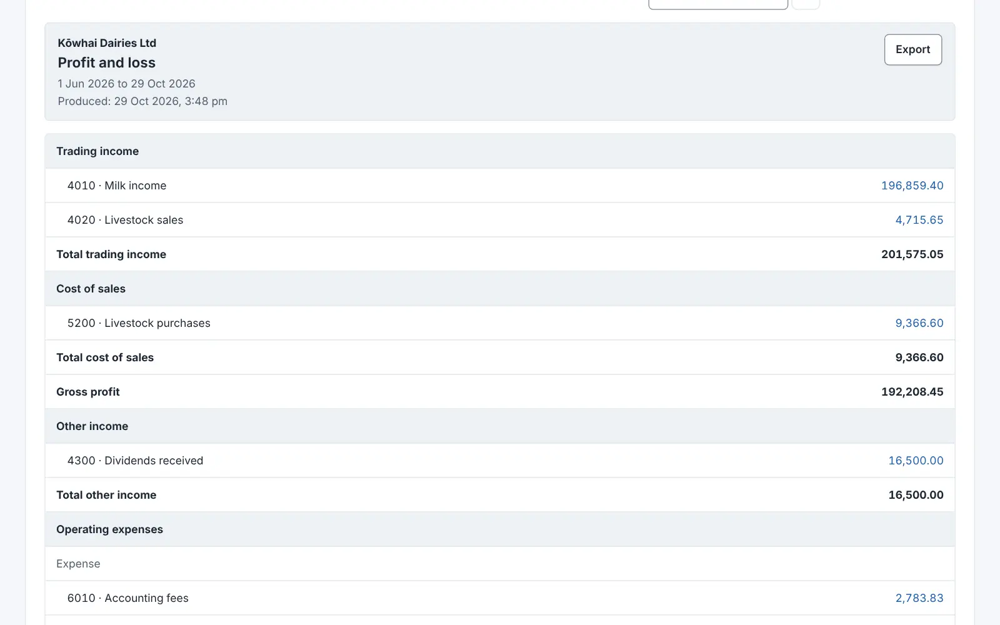
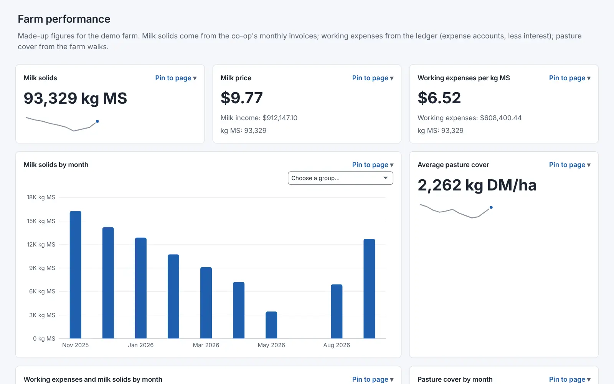
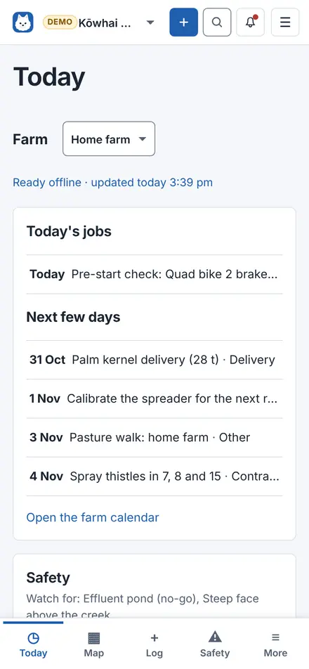
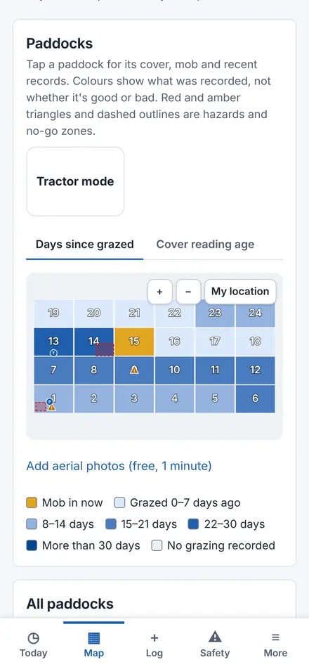
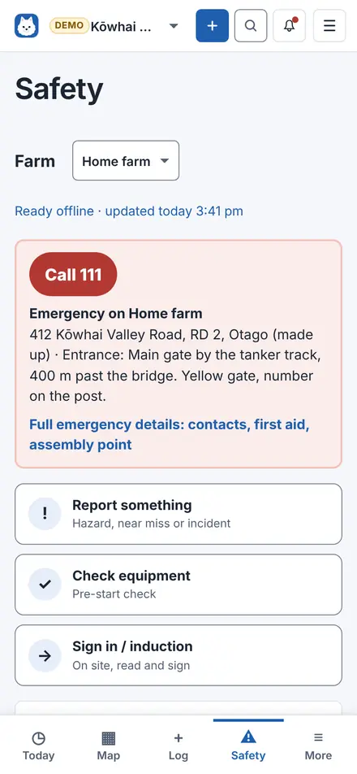
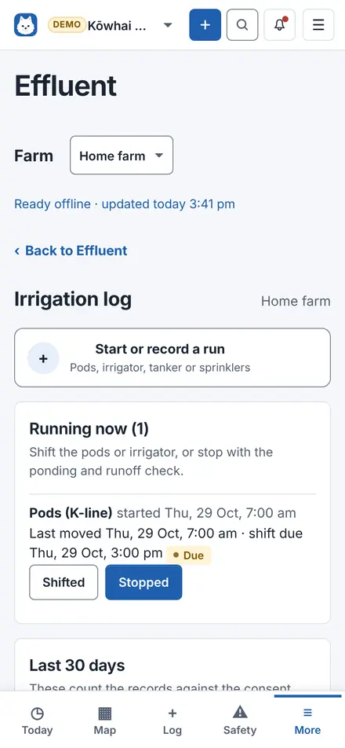
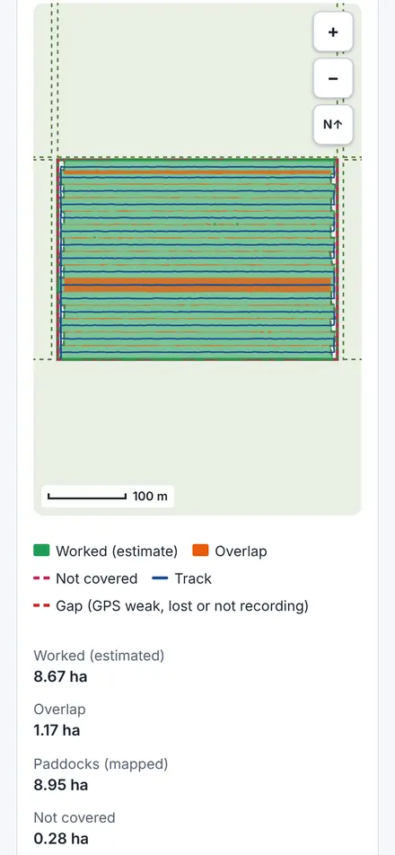

<p align="center">
  
</p>

<h1 align="center">Tohyee</h1>

<p align="center">
  <strong>Your business. Your books. Your server.</strong><br />
  Free, open-source accounting made in New Zealand: invoices, GST, payroll,
  jobs, CRM and analytics, plus paddocks, farm safety and effluent records on
  your phone, on a server you control.
</p>

<p align="center">
  <a href="https://github.com/Willy-nz/Tohyee/releases/latest"></a>
  <a href="https://github.com/Willy-nz/Tohyee/actions/workflows/ci.yml"></a>
  <a href="LICENSE"></a>
</p>

<p align="center">
  <a href="https://willy-nz.github.io/Tohyee/"><strong>Website</strong></a> ·
  <a href="https://github.com/Willy-nz/Tohyee/releases/latest"><strong>Download</strong></a> ·
  <a href="docs/FEATURES.md">Features</a> ·
  <a href="https://github.com/Willy-nz/Tohyee/issues">Report a problem</a>
</p>

Tohyee keeps your books on a computer you control, like a media server at
home, with no monthly fee. One Tohyee server can hold many organisations, and
**each organisation gets its own PostgreSQL database**, so each can be backed
up, restored or moved on its own.

**Accounting you can check.** Bank matches, bank rules, bills read from your
inbox and AI drafts are suggestions until someone says OK. PostgreSQL itself
refuses unbalanced journals and edits to posted history. Every accounting rule
starts as a worked example with real numbers
([more than a thousand](docs/ACCOUNTING-EXAMPLES.md)), and more than 2,000
automated tests run them against a real database before any change is
accepted.

> **Status: early development.** This README describes the current `main`
> branch, including features ahead of packaged releases. Try a test
> organisation first and review returns and reports before relying on them.
> Tohyee is free software provided as is, with no warranty (see the
> [licence](LICENSE)).

**Release availability, checked 30 October 2026:** the latest release is
[v0.19.0](https://github.com/Willy-nz/Tohyee/releases/tag/v0.19.0)
([notes](docs/releases/0.19.0.md)). Check the
[latest release](https://github.com/Willy-nz/Tohyee/releases/latest) for what
each download includes, or [run from source](#run-it-locally).

**Want a look first?** On the server, choose **Add demo farm…** on the
Organisations page of the Tohyee server app (or the server settings in the
browser): Tohyee makes you, or a login you choose, your own copy of Kōwhai
Dairies Ltd, a made-up Otago dairy farm with about 18 months of books, payroll,
GST, farm records and Analytics reports. It appears in the organisation list,
marked DEMO on every page. Nothing is emailed or connected from it; reset or
delete it there whenever you like (see [the demo farm](docs/DEMO-FARM.md)).

**Just want to use it?** Download `TohyeeSetup` from the
[latest release](https://github.com/Willy-nz/Tohyee/releases/latest) and see
[Running on a server](#running-on-a-server). The feature overview below covers
what you can use; developer and server setup instructions follow it.

<p align="center">
  
</p>

## For small businesses and bookkeepers

| | |
| --- | --- |
| **Bank feeds and reconciliation**<br />Akahu, SimpleFIN, Stripe, PayPal and Wise, or statement files; suggested matches are one click. | **GST, the NZ way**<br />The GST101A return box by box, with the documents behind every figure. |
|  |  |
| **Reports and year end**<br />Profit and loss, balance sheet, budgets, cash flow forecast and year-end statements as one PDF. | **Analytics like Power BI**<br />Report pages, click-to-filter, drill-down by financial year, and a PowerPoint add-in for live slides. |
|  |  |

Also: invoices, quotes, repeating invoices and Pay now links; bills inbox and
approvals; NZ payroll with payday filing files; timesheets, rosters and jobs;
a built-in CRM; Tier 3 and Tier 4 reports for not-for-profits; income tax
workings (not yet reviewed by an accountant); and AI apps such as Claude.ai
or ChatGPT connected by signing in.

<sub>Screenshots show the books of Kōwhai Dairies Ltd, Tohyee's made-up demo farm.</sub>

## For farms, on your phone

| Today | Map | Safety | Effluent | Tractor mode |
| :---: | :---: | :---: | :---: | :---: |
|  |  |  |  |  |

- **The phone app:** add Tohyee to your home screen from your own server (no
  app store; needs its https address). Farm maps, paddocks, a year of
  pasture and grazing, jobs, checklists and safety details are kept on the
  phone automatically, and logs, photos, safety reports and checks made
  without signal are sent once when you're back ([guide](docs/MOBILE-APP.md)).
- **Android app (optional):** an APK from the releases that opens your own
  server and adds locked-screen tractor recording, reminders as
  notifications and the phone's camera ([guide](docs/MOBILE-APP.md#the-android-app)).
- **Farm screens:** Today, Map, Log, Safety and More along the bottom, a
  farm walk that saves each reading as you go, and a **Farm staff** role
  that records field work without seeing the books.
- **Farm safety:** hazards and no-go zones on the map, incidents, inductions,
  gate sign-in, pre-start checks, training, chemicals, a WorkSafe pack and a
  weekly copy off the farm. Records can't be quietly changed
  ([details](docs/FARM-SAFETY.md)).
- **Effluent** (on `main`, in the next release): systems, daily irrigation
  log, pond levels, checks and servicing, incidents and a council pack you
  download ([details](docs/FARM-EFFLUENT.md)).
- **Tractor and spreader mode:** the worked area, overlaps and GPS gaps from
  the phone, saved to the paddock diary, with GeoJSON and GPX exports.
- Plus paddock maps, pasture and feed, soil tests, fertiliser plans, the
  farm calendar from your email, several farms, livestock for tax and farm
  benchmarks.

Safety and effluent keep records; they don't decide what the law or your
consent needs, and Tohyee never sends anything to WorkSafe or a council. Phone
GPS is an estimate. The phone app and tractor mode haven't been tried on a
real phone or in a paddock yet.

<sub>Farm screenshots show Kōwhai Dairies Ltd, Tohyee's demo farm. Everything in it is made up.</sub>

## Recent releases

| Release | What's new |
| --- | --- |
| **Next** (on `main`) | Effluent management; aerial photos on farm maps with your own LINZ key. |
| [**0.19.0**](docs/releases/0.19.0.md) | Farm as its own app with tabs on every farm page, Use my location on every map, opt-in farm team locations, install steps for each browser, and no big Call 111 button. |
| [**0.18.0**](docs/releases/0.18.0.md) | Effluent management, easy LINZ aerial photos, records that say what's known, phone app fixes, and a richer demo farm. Includes 0.15.0–0.17.0 (not published separately): Tohyee on your phone, tractor mode, farm safety, farm screens, Farm staff, passkeys, invites and Next.js security fixes. |
| [**0.17.0**](docs/releases/0.17.0.md) | Tohyee on your phone: home screen install, offline farm information, work without signal, tractor and spreader mode. Includes 0.15.0 and 0.16.0: farm safety, farmer-friendly farm screens, the Farm staff role, passkeys, invites, and Next.js security fixes. |
| [**0.14.0**](docs/releases/0.14.0.md) | The demo farm, and sign-in security fixes. |
| [**0.13.0**](docs/releases/0.13.0.md) | Connect AI apps by signing in, and the PowerPoint add-in. |
| [**0.12.0**](docs/releases/0.12.0.md) | Analytics much closer to Power BI, several farms, backups you can check, IRD account file imports and Sign in with Google. |
| [Older](https://github.com/Willy-nz/Tohyee/releases) | Income tax (0.10.0), farms and livestock (0.8.0), and more. |

These features don't cover every workflow or tax treatment. See the scope below
and the [feature register](docs/FEATURES.md).

## What it does

**Sales**
- Quotes, invoices and credit notes, with GST worked out per line (tax
  exclusive, inclusive or no tax); numbered on approval with no gaps, and
  voided rather than deleted.
- Repeating invoices, payment terms, customer payments (one or several
  invoices at once), overpayments and refunds, and customer statements.
- Products and services, price levels, salespeople, and print or save as PDF.
- Email invoices, quotes, credit notes, purchase orders and statements (as
  PDFs, in HTML emails with the organisation's logo) from the organisation's
  own Microsoft 365, Outlook, Gmail or Google Workspace mailbox (signed in
  once), or any other email account.
- **Pay now** links on invoices through the organisation's own Stripe or
  PayPal account, with the payments recorded for you.
- Shopify customers, products, orders, refunds and payouts; WooCommerce
  orders and refunds. Shopify sync is implemented and tested with simulated
  provider responses, but has not yet been verified against a live store.
  Connections are inbound; stock and other changes are not written back.

**Purchases**
- Bills (due dates from each supplier's payment terms), repeating bills,
  supplier credit notes, purchase orders billed in parts, paying one or
  several bills at once, and expense claims with mileage.
- A bills inbox (bills uploaded or read from a mailbox, made into drafts),
  warnings about possible duplicate bills, and approval rules for who
  approves what.

**Bank**
- Bank and credit card accounts. Import statements (CSV, Excel, OFX, QIF,
  CAMT.053, MT940), have statement files picked up from a folder or
  mailbox, or use a bank feed: Akahu for NZ banks, SimpleFIN for overseas
  banks, and Stripe, PayPal and Wise. Reconcile each line by matching, paying
  invoices or bills, spend or receive money, or a transfer. Bank rules (with
  conditions and split lines) and contact defaults fill in the usual ones.

**GST and reports**
- GST return (GST101A, boxes 5-15) on the invoice, payments or hybrid basis,
  with a GST audit report listing the documents behind every box, and a
  GST filing frequency setting (monthly, two-monthly or six-monthly).
- Trial balance (this year's income and expenses, earlier years' profit in
  retained earnings, as in NetSuite), profit and loss, balance sheet, account transactions, journal
  report, aged receivables and payables, budgets with budget vs actual, and
  custom reports with your own layout.
- A cash flow forecast that leads with the lowest balance, any shortfall
  and a balance chart; consolidation of several organisations (with
  exchange rates from the European Central Bank), and report commentary
  that the organisation's connected AI can suggest and a person checks.

**Income tax** (not yet reviewed by an accountant)
- Taxable income from the books for a company or sole trader, with
  non-deductible, entertainment, business-use and not-taxable treatments,
  losses, credits, imputation credits and overseas tax; any balance date.
- Standard provisional tax instalments (with late-filed and extension of
  time rules), the expected end-of-year tax, and an estimate of use-of-money
  interest.
- Tax depreciation and Investment Boost per fixed asset, the imputation
  credit account, and the IR10, IR4 and IR3 boxes once the year ends.
- IRD documents uploaded and read by your own AI; you check each figure
  before it's used. Tohyee doesn't file returns, pay IRD or ask for your
  myIR password.

**Accounting**
- A starting NZ chart of accounts, manual journals, corrections by reversal,
  and month-end and year-end close with a checklist (no closing journals). The database itself refuses unbalanced journals and edits
  to posted history.
- Stock at weighted-average cost per location, with transfers, stocktakes and
  landed cost. A fixed asset register with depreciation runs and disposals.
  Foreign-currency revaluation.
- Departments, classes and locations on every line, custom fields and custom
  segments, and projects with time tracking.

**Projects and jobs**
- Projects with tasks, time at each person's cost rate, linked expenses,
  invoicing what's unbilled, and profitability and time reports.
- A **job** is a project with a site address, a contact on site, a checklist
  and an optional service interval. Visits are booked on a calendar for a
  member (overlaps are flagged). On a phone, Start and Finish fill in the
  hours, which the person confirms into project time; checklist ticks record
  who and when, and photos and a signature are kept with the visit.
- Materials used on a job go on the project invoice as item lines, so their
  stock and cost of sales move when it's approved. Services due show on the
  Jobs page. Visits download as a calendar file for Google or Microsoft
  calendar (one way).

**Payroll**
- NZ payroll: employees, pay runs with PAYE, ACC, student loan, KiwiSaver
  and ESCT, Holidays Act leave, timesheets, payslips, bank files for paying
  wages, payday filing files for IRD, and payroll reports.
- **Rosters** by area and week, costed as wages plus employer KiwiSaver
  against a weekly budget. Rostering someone on a day they're unavailable
  needs a reason; shifts in booked leave are flagged and not counted.
  Publishing shows employees their shifts under My shifts.
- **Clocking in** on a shared device at the shop, with a PIN, for staff with
  or without a login. The device never signs in to the books. Clocked time
  goes onto the timesheet marked "from clock-in" for approval; a missed
  clock-out waits for a manager. The roster shows rostered against clocked
  hours.

**CRM**
- Companies, people, leads and opportunities with shared history, tasks,
  calls, meetings, custom fields, record types and page layouts.
- Leads entered or imported from CSV/Excel, captured from web forms or a
  mailbox, then converted into a company, person and optional opportunity.
- Configurable pipeline stages, deal products, discounts and quote revisions;
  forecasts by owner or team, quotas and sales dashboards.
- Sales rep and sales manager roles with scoped deals and tasks. Sales users
  share the address book but do not get access to accounting or payroll.
- Duplicate suggestions and controlled merges, follow-up rules, campaigns and
  task-based sequences. Sequences create tasks; they do **not** send email
  automatically.
- Gmail and Microsoft 365 email/calendar sync; optional sending from the
  connected mailbox with templates and a human checking before Send.

**Analytics**
- Reusable CSV and Excel (`.xlsx`) sources, with one sheet per Excel source,
  previews, confirmed column types and manual or scheduled reloads.
- Copy the organisation's books and CRM into analytics. Filter, join, append,
  unpivot and calculate fields using repeatable shaping steps.
- Dashboards with charts, key figures, date ranges and slicers; pivot tables
  with subtotals, drill-down and CSV/Excel exports. Pin tiles onto supported
  dashboard pages.
- Share selected dashboards with **report viewers**, who cannot browse the
  underlying books or source tables.
- Bring report attachments **into** analytics from a selected mailbox folder
  or label. This is data ingestion, not a promise of scheduled outbound
  dashboard emails or direct Looker/Google Ads connectors.

**Farming**
- Farms and paddocks drawn or imported (GeoJSON, KML/KMZ, shapefile), with
  LINZ aerial photos behind; fertiliser plans against what was bought and
  spread; soil tests and samples; farm benchmarks per kgMS, hectare, cow and
  stock unit.
- Pasture and feed: cover readings (typed or imported), growth, the feed
  wedge, grazings and supplements fed. Records only: no feed plan or targets.
- A **farm calendar** read from your own Gmail or Outlook: vet visits,
  deliveries, stock trucks, contractors, deadlines and meetings, with
  anything unclear kept aside to check. Add your own items, set repeats,
  share chosen items with the farm team (after a preview), and subscribe
  to it from your phone or Google, Apple or Outlook calendar with a
  private link. Only you see your mailbox. Not yet tried with a real
  mailbox.
- A **Farming API** for your own apps (keys you make, choosing exactly what
  each may read or record), with a guide and a soil sampling app.
- An AI workspace: a farm notebook and files your own AI can read, tables
  and dashboards it builds, and livestock movements it suggests for you to
  accept.
- **On a phone:** Today, Map, Log, Safety and More, a farm walk, offline
  farm information and work without signal, tractor and spreader mode, and
  a Farm staff role ([phone app](docs/MOBILE-APP.md)).
- **Farm safety:** hazards, incidents, inductions, pre-start checks,
  training, chemicals, emergency details, a WorkSafe pack and a weekly copy,
  with every edit kept ([farm safety](docs/FARM-SAFETY.md)).
- **Effluent** (on `main`): systems, daily logs, pond levels, checks and a
  council pack ([effluent](docs/FARM-EFFLUENT.md)).

**Livestock**
- An optional Accounting module for dairy and beef cattle, sheep, deer and
  goats.
  Opening head counts and values, births, purchases, sales, deaths, ageing,
  class changes and location transfers, with head count reconciliation.
- Supported **herd scheme** and **national standard cost** valuations,
  election evidence, sourced annual rates, trading statements and review
  before a year-end journal is approved. IRD 2026 rates are included; other
  years require sourced rates entered by an admin.
- Agent account sales record stock, deductions and the net receivable through
  linked invoices, bills and clearing payments.
- Monthly management values show quantity and price changes using the farm's
  values per head. They are **reports only**: they do not post journals or
  alter tax valuations.
- High-priced animals (valued apart from their class at IRD's rate) and the
  Chatham Islands herd value ratio.
- Classes held for sale shown as current assets, and where the herd scheme
  revaluation goes tied to your reporting basis (profit and loss only for
  general purpose statements).
- **Scope limits:** this is not every NZ livestock tax rule. Pigs,
  associated-person transfers, long-term bailments, purchased bobby calves
  and a few other cases are refused rather than guessed. Farm budgets,
  forecasts and industry benchmarking are still planned. See
  [issue #243](https://github.com/Willy-nz/Tohyee/issues/243) and the
  [worked examples and limitations](docs/ACCOUNTING-EXAMPLES.md).

**Everything else**
- Notes, files and history on transactions and contacts.
- Organisation roles for accounting, CRM sales, farm staff and shared
  analytics; invites from People and roles; two-step sign-in, passkeys, and
  Sign in with Google for invited people.
- AI apps (Claude.ai, ChatGPT and others) connected by signing in, and a
  PowerPoint add-in for live Analytics reports.
- Nightly encrypted backups checked weekly, a recovery kit and restore
  wizard, restore as a copy, and remote access.
- Works on phones: a ☰ menu and line editors that stack.

See [docs/FEATURES.md](docs/FEATURES.md) for the full list, what's
deliberately not built, and what's next.


## Run it locally

You need Node.js 22 or 24 and Docker (for PostgreSQL).

```bash
npm install
npm run db:start                  # PostgreSQL 17 on localhost:5432 (for development only)
cp .env.example .env.local        # then set SETUP_TOKEN to a long random value
npm run dev                       # http://localhost:3000
```

The first visit goes to **/setup**: enter the `SETUP_TOKEN` and create the
first server admin. Then, on the same computer, open the **server settings**
and create an organisation under **Organisations**. On Windows that's the
**Tohyee server app**: the Tohyee icon by the clock (it starts when you sign in
to Windows) or "Tohyee server settings" in the Start menu. Elsewhere it's
http://127.0.0.1:3001/server (the main port + 1). It gets its own database with a starting NZ chart of
accounts, and you're its owner.

Server settings (organisations, users, remote access, email, updates) only
open on the server computer itself: they're refused over the network and
through the Cloudflare Tunnel. On Windows the server app's icon also shows
whether Tohyee is running, and can restart it or back it up. Change the port with `TOHYEE_ADMIN_PORT`. In
Docker or on Linux, use the command-line tool instead, which does everything
the server settings do (see [Server settings from the command line](#server-settings-from-the-command-line)).

Database migrations run automatically when the server starts. To run them by
hand: `npm run db:migrate`.

## Checks

```bash
npm run lint
npm run typecheck
npm test                          # database tests need TEST_DATABASE_URL, see .env.example
npm run build
```

`npm test` includes the worked examples in
[docs/ACCOUNTING-EXAMPLES.md](docs/ACCOUNTING-EXAMPLES.md), run against a real
PostgreSQL database. CI runs all four checks on pull requests and pushes to
`main`, on Node 22 and 24 with PostgreSQL 17.

## Running on a server

**Windows:** download `TohyeeSetup-<version>.exe` from the
[latest release](https://github.com/Willy-nz/Tohyee/releases/latest) and run
it. It installs Tohyee with its own PostgreSQL (nothing else to install) as
two Windows services, `Tohyee` and `TohyeePostgres`, that start whenever the
computer starts, even before anyone signs in. The last page of the installer
shows the setup token for creating the first admin login. Open Tohyee at
http://localhost:3000 (Start menu: **Open Tohyee**). Backups run every night,
encrypted; **Back up Tohyee** in the Start menu (or **Back up now** in the
tray icon's menu) runs them straight away. Data and settings
live in `%ProgramData%\Tohyee` and are kept when you update or uninstall.
The installer is built and tested on Windows by
`.github/workflows/windows-installer.yml` from [`installer/windows`](installer/windows).

**Docker:** `tohyee-v<version>-windows-docker.zip` runs Tohyee in Docker
Desktop instead (see [`deploy/windows`](deploy/windows) and its
`README.txt`, including where the backups go). The image is `ghcr.io/willy-nz/tohyee:<version>`. It needs
`DATABASE_URL` (a PostgreSQL 15+ login that can create databases), for the
first run `SETUP_TOKEN`, and `TOHYEE_SECRET_KEY` (32+ random characters: it
turns on two-step sign-in and encrypts stored secrets; the installers create
it); it listens on port 3000.

**Linux without Docker:**

```bash
npm run build
npm run package:release           # dist/release/tohyee-v<version>-linux-x64.tar.gz
```

On the server, unpack the bundle, set `DATABASE_URL`, `TOHYEE_SECRET_KEY`
(and `SETUP_TOKEN` for the first run) in the environment, and start it with `PORT=3000 ./start.sh`.
Put it behind HTTPS (e.g. Caddy or nginx) if it's reachable beyond your own
network.

**From anywhere (phone or laptop):** there are three ways, and each gives
Tohyee an https address without opening ports on your router. Only one is on
at a time. On Windows they're on the Tohyee server app's **Remote access**
page, which shows the address with a QR code to scan with your phone.

- **A Tohyee address (recommended for most):** one click, no sign-up. Tohyee
  asks the Tohyee address service (run by the Tohyee project) for an address
  like `https://k7m2q9.tohyee.example` and runs Cloudflare's connector for it.
  Your books still stay on this computer; the address service never sees
  them. From the command line: `remote-access address --on`. The service
  address can be changed with `TOHYEE_ADDRESS_SERVICE_URL`. (The service isn't
  running yet; until it is, Tohyee says so.)
- **Your own domain (Cloudflare):** free for businesses; you need a domain on
  Cloudflare. In the server app, **Connect to Cloudflare** signs you in to
  Cloudflare in your browser, makes the tunnel, adds an address such as
  `https://books.example.nz` to your domain and turns it on. You can also
  paste a tunnel token from Cloudflare's dashboard (the server app, or
  `remote-access set --on --token` on the command line). The Windows installer
  and Docker image include Cloudflare's `cloudflared`; on Linux, install it or
  set `TOHYEE_CLOUDFLARED_PATH`.
- **Tailscale Funnel (Windows):** the simplest set-up: the server app installs
  Tailscale if needed (Windows asks for permission), you sign in to Tailscale
  once in your browser, and it turns on Funnel for Tohyee
  (`https://<computer>.<tailnet>.ts.net`). Tailscale's free plan is for
  non-commercial use only; businesses need a paid Tailscale plan (from US$8
  per user a month, see https://tailscale.com/pricing). Tohyee never sees your
  Tailscale login.

Whichever way, everyone signs in with a password and an authenticator app
(two-step sign-in), which is required whenever `TOHYEE_SECRET_KEY` is set (the
installers set it), and phone access can't be turned on without it. Set up
Email in the server settings too, for security alerts and lost-phone reset
links.

**Backups:** every night (2am by default) Tohyee backs up each organisation,
and its own database of users and settings, into files in the backup folder:
one sub-folder per organisation, encrypted with the server's own recovery
key, each checked after it's written, keeping the last 14
daily and 12 monthly backups, and reading the newest ones back to check them
again every week. Point the folder at a OneDrive (or other cloud-synced)
folder to get copies off the computer; Tohyee can't see whether OneDrive
uploaded them, so its status says off-site is "not verified", and a copy on a
USB drive kept elsewhere now and then is still worth having. Restoring makes a copy of
the organisation, with the same people, so the current books are never
overwritten. It's all in the server settings under **Backups** (or
`backups ...` in the command-line tool). **Save the recovery kit somewhere
safe that isn't the backup folder**, such as a password manager: without it
the backups can't be opened on another computer. It's a recovery code, or a
file locked with a passphrase you keep elsewhere, and holds nothing but the
recovery key. Backups shows it (after your password) and checks your saved
copy when you give it back; until someone has, server admins see a reminder
on every page. To restore on a new server, give the recovery code when
restoring (the new server keeps its own keys). See
[docs/BACKUP-RECOVERY.md](docs/BACKUP-RECOVERY.md). pg_dump and pg_restore come with the Windows installer and the Docker
image; elsewhere they need to be on the PATH (or set `TOHYEE_PG_BIN`).

### Server settings from the command line

For Docker and Linux servers (and for anyone locked out), the command-line
tool covers organisations, users, remote access, email and updates. It works
straight against the database, on the server itself, and records each change
in the audit trail as `cli`. In Docker it's in the image:

```bash
docker compose exec tohyee node tohyee-admin.cjs help
docker compose exec tohyee node tohyee-admin.cjs organisations list
docker compose exec tohyee node tohyee-admin.cjs organisations create --id green-island --name "Green Island" --owner you@example.com
docker compose exec tohyee node tohyee-admin.cjs users set-password --email you@example.com
docker compose exec tohyee node tohyee-admin.cjs demo add --owner you@example.com
```

From a checkout of this repository (with `npm install` done and
`DATABASE_URL` pointing at the core database) it's `npm run admin -- <same
arguments>`. Passwords and tokens are read from `TOHYEE_PASSWORD`,
`TOHYEE_EMAIL_PASSWORD` and `TOHYEE_TUNNEL_TOKEN`, or asked for without
showing what you type. Remote access changes take effect when Tohyee next
starts, because the running server runs the tunnel.

**Releases:** pushing a `v*` tag builds a release bundle and attaches it to a
GitHub release (`.github/workflows/release-server-bundle.yml`); the tag must
match the version in `package.json`. Server admins can check for new releases
under **Updates**.

## Documentation

- [SECURITY.md](SECURITY.md): how to report a vulnerability privately
- [docs/ANALYTICS-STUDIO.md](docs/ANALYTICS-STUDIO.md): analytics workspace
- [docs/ARCHITECTURE.md](docs/ARCHITECTURE.md): tenancy, logins and roles,
  migrations, financial integrity rules
- [docs/ACCOUNTING-EXAMPLES.md](docs/ACCOUNTING-EXAMPLES.md): worked examples
  with numbers (the acceptance tests)
- [docs/FEATURES.md](docs/FEATURES.md): scope and roadmap
- [docs/STYLE-GUIDE.md](docs/STYLE-GUIDE.md): code conventions
- [.github/copilot-instructions.md](.github/copilot-instructions.md): rules for
  AI coding agents

## API

JSON over HTTP. Every route needs a signed-in session cookie, except
`/api/health`, sign-in, sign-out and first-time setup. Organisation routes take
an `organisationId` and check your role in that organisation. Commands that
create things take an `idempotencyKey`, so retries are safe. Browser requests
that change something are refused if they come from another site (checked with
the `Origin` and `Sec-Fetch-Site` headers).

| Area | Routes |
| --- | --- |
| Auth | `GET/POST /api/auth/setup`, `POST /api/auth/login`, `POST /api/auth/logout`, `GET /api/auth/session`, `POST /api/auth/password` |
| Server admin | `GET/POST /api/admin/organisations`, `PATCH /api/admin/organisations/:id`, `POST /api/admin/organisations/:id/repair`, `GET/POST /api/admin/users`, `PATCH /api/admin/users/:id`, `GET /api/updates/latest-release` |
| Organisation | `GET/PATCH /api/organisations/:id/settings`, `GET/POST /api/organisations/:id/members`, `PATCH/DELETE /api/organisations/:id/members/:userId` |
| Accounts | `GET/POST /api/accounts`, `PATCH /api/accounts/:id` |
| Contacts | `GET/POST /api/contacts`, `PATCH /api/contacts/:id` |
| Invoices | `GET/POST /api/invoices` (`?awaitingPayment=true` for approved invoices with an amount due, `?contactId=` for one customer's), `GET/PATCH/DELETE /api/invoices/:id` (GET includes the credit applied), `POST /api/invoices/:id/approve`, `POST /api/invoices/:id/void` |
| Customer payments | `GET/POST /api/invoices/:id/payments`, `POST /api/invoices/:id/payments/:paymentId/void` |
| Sales credit notes | `GET/POST /api/credit-notes` (`?status=`, `?contactId=`, `?hasRemainingCredit=true`), `GET/PATCH/DELETE /api/credit-notes/:id`, `POST /api/credit-notes/:id/approve`, `POST /api/credit-notes/:id/void`, `GET/POST /api/credit-notes/:id/applications`, `POST /api/credit-notes/:id/applications/:applicationId/remove`, `GET/POST /api/credit-notes/:id/refunds`, `POST /api/credit-notes/:id/refunds/:refundId/void` |
| Bills | `GET/POST /api/bills` (`?status=` filters by draft, approved or voided; `?awaitingPayment=true` for approved bills with an amount due; `?contactId=`), `GET/PATCH/DELETE /api/bills/:id` (`GET` includes the credit applied), `POST /api/bills/:id/approve`, `POST /api/bills/:id/void` |
| Supplier payments | `GET/POST /api/bills/:id/payments`, `POST /api/bills/:id/payments/:paymentId/void` |
| Supplier credit notes | `GET/POST /api/supplier-credit-notes` (`?status=`, `?contactId=`, `?hasRemainingCredit=true`), `GET/PATCH/DELETE /api/supplier-credit-notes/:id`, `POST /api/supplier-credit-notes/:id/approve`, `POST /api/supplier-credit-notes/:id/void`, `GET/POST /api/supplier-credit-notes/:id/applications`, `POST /api/supplier-credit-notes/:id/applications/:applicationId/remove`, `GET/POST /api/supplier-credit-notes/:id/refunds`, `POST /api/supplier-credit-notes/:id/refunds/:refundId/void` |
| Ledger | `GET/POST /api/ledger/journals`, `GET /api/ledger/journals/:id`, `POST /api/ledger/journals/corrections`, `GET/PATCH /api/ledger/period-controls`, `GET/POST /api/ledger/revaluations` |
| Stock | `GET/POST /api/inventory/movements` |
| Reports | `GET /api/reports/trial-balance`, `/profit-and-loss`, `/balance-sheet`, `/inventory-valuation` |
| GST return | `GET/POST /api/reports/gst-return` (`?periodStart=&periodEnd=`; `POST` works it out with `adjustments`), `GET/POST /api/gst-returns` (`POST` marks a return as filed, admins), `GET /api/gst-returns/:id` |
| Notes, files and history | `GET /api/records/:type/:id` (type: `journal`, `invoice`, `bill`, `credit-note`, `supplier-credit-note`, `contact`), `POST /api/records/:type/:id/notes`, `PATCH/DELETE /api/records/:type/:id/notes/:noteId`, `POST /api/records/:type/:id/attachments` (multipart `file`), `GET/DELETE /api/records/:type/:id/attachments/:attachmentId` |
| Tax | `GET/POST /api/tax/codes` |
| Health | `GET /api/health` |

## Contributing

Issues and pull requests are welcome. Please read
[docs/ARCHITECTURE.md](docs/ARCHITECTURE.md) and
[docs/STYLE-GUIDE.md](docs/STYLE-GUIDE.md) first. Accounting behaviour needs a
worked example with numbers in
[docs/ACCOUNTING-EXAMPLES.md](docs/ACCOUNTING-EXAMPLES.md) and a test, and all
four checks above must pass.

## Licence

[GNU AGPL v3](LICENSE). The Tohyee logo (a Japanese Spitz) is `assets/logo.svg`.
