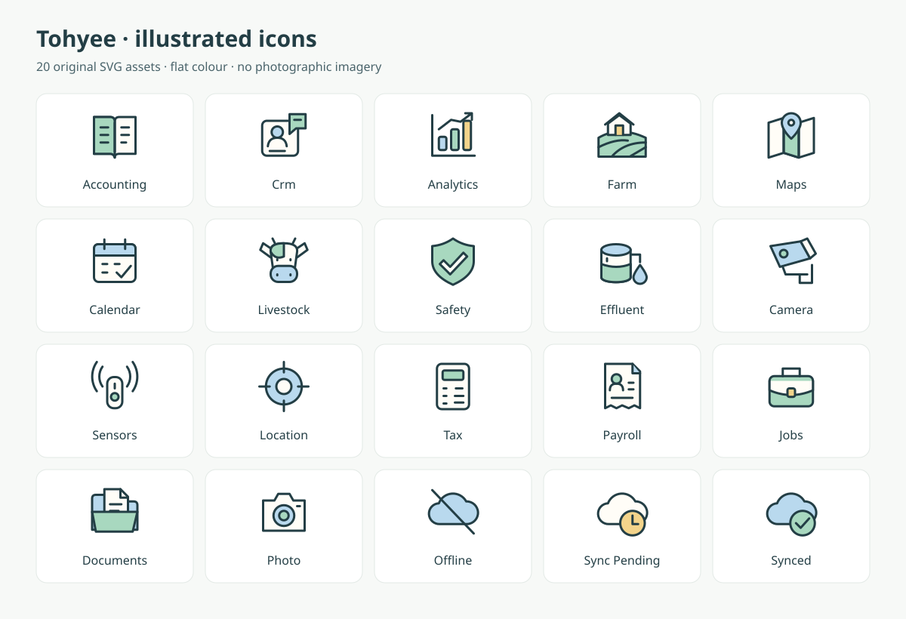

# Illustrated icons for Tohyee

Actual ready-to-use vector assets for issue #509, following the user's request for simple illustrations instead of realistic AI imagery. These are assets for Claude to integrate, not a deployed UI redesign.



## Files and use

Each standalone SVG is in `public/illustrations/icons/`. All use a 64 × 64 viewBox, transparent background, rounded 2.4-unit outlines and flat fills. Original geometric artwork authored for Tohyee; no stock art, external font, raster image, script, external request or new dependency. Distributed under this repository's existing AGPLv3 license.

Use at 40–64 CSS pixels in module tiles, overview sections and compact empty states. These are small illustrations, not replacement 16-pixel toolbar glyphs. Keep the existing simpler UI icons for tiny controls. Provide an opaque light backing when displaying this palette on dark surfaces; do not invert the entire SVG.

HTML (in the app; next to a visible label):

```html

<span>Farm</span>
```

For a meaningful standalone image, supply a useful alt, e.g. `alt="Farm"`. For a button, give the button an accessible name and keep the image decorative. Keep text labels and don't convey status only through colour.

The separate static marketing website does not automatically serve the application's public folder. Copy only selected assets into its own assets directory during integration, retaining this provenance and keeping duplicates synchronised.

## State meanings

- `offline`: disconnected; does not mean data is available offline.
- `sync-pending`: records await synchronisation; not a success state.
- `synced`: confirmed synchronisation only.
- `location`: action to centre on/request the user's location; not a live-tracking guarantee.
- Camera and sensor artwork is available for future features, but must not imply those features have shipped.

## Inventory

| Purpose | File |
|---|---|
| Accounting | `accounting.svg` |
| Crm | `crm.svg` |
| Analytics | `analytics.svg` |
| Farm | `farm.svg` |
| Maps | `maps.svg` |
| Calendar | `calendar.svg` |
| Livestock | `livestock.svg` |
| Safety | `safety.svg` |
| Effluent | `effluent.svg` |
| Camera | `camera.svg` |
| Sensors | `sensors.svg` |
| Location | `location.svg` |
| Tax | `tax.svg` |
| Payroll | `payroll.svg` |
| Jobs | `jobs.svg` |
| Documents | `documents.svg` |
| Photo | `photo.svg` |
| Offline | `offline.svg` |
| Sync Pending | `sync-pending.svg` |
| Synced | `synced.svg` |

## Integration handoff

Use Accounting, CRM, Analytics and Farm in the module chooser; use the matching Farm illustrations for maps, livestock, safety and effluent. Keep photography capture/profile photos as user data, not decorative generated art. Do not add all 20 illustrations to one operational page. The preview is a review sheet only, not a proposed application layout.

This delivery intentionally changes assets/documentation only. Integrate selectively into the current layouts under #509, with before/after mobile and desktop screenshots, rather than rebuilding the artwork from prose.
