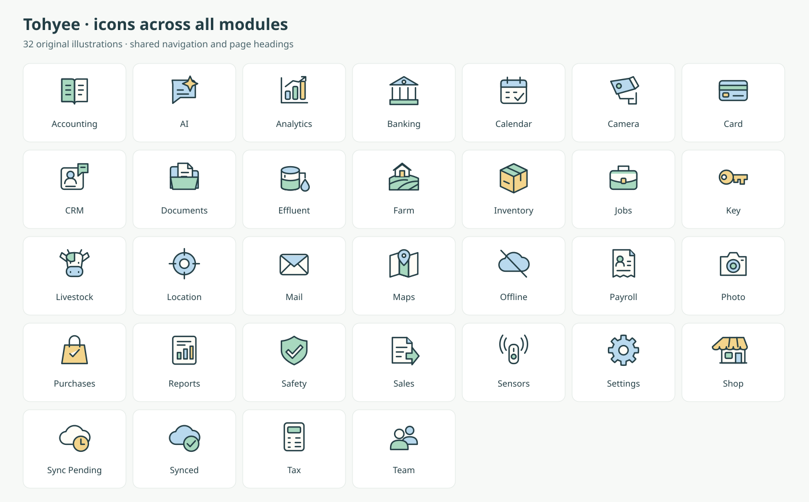

# Illustrated icons for Tohyee

Actual ready-to-use vector assets for issue #509, following the user's request for simple illustrations instead of realistic AI imagery. The draft PR now integrates selected icons into the app launcher, Farm menu and navigation, and Sales/Purchases overviews. Nothing is deployed until the PR is merged and released.



## Files and use

Each standalone SVG is in `public/illustrations/icons/`. All use a 64 × 64 viewBox, transparent background, rounded 2.4-unit outlines and flat fills. Original geometric artwork authored for Tohyee; no stock art, external font, raster image, script, external request or new dependency. Distributed under this repository's existing AGPLv3 license.

Use at 40–64 CSS pixels in module tiles, overview sections and compact empty states. These are small illustrations, not replacement 16-pixel toolbar glyphs. Keep the existing simpler UI icons for tiny controls. Provide an opaque light backing when displaying this palette on dark surfaces; do not invert the entire SVG.

HTML (in the app; next to a visible label):

```html

<span>Farm</span>
```

For a meaningful standalone image, supply a useful alt, e.g. `alt="Farm"`. For a button, give the button an accessible name and keep the image decorative. Keep text labels and don't convey status only through colour.

The separate static marketing website does not automatically serve the application's public folder. Copy only selected assets into its own assets directory during integration, retaining this provenance and keeping duplicates synchronised.

## State meanings

- `offline`: disconnected; does not mean data is available offline.
- `sync-pending`: records await synchronisation; not a success state.
- `synced`: confirmed synchronisation only.
- `location`: action to centre on/request the user's location; not a live-tracking guarantee.
- Camera and sensor artwork is available for future features, but must not imply those features have shipped.

## Inventory

| Purpose | File |
|---|---|
| Accounting | `accounting.svg` |
| Crm | `crm.svg` |
| Analytics | `analytics.svg` |
| Farm | `farm.svg` |
| Maps | `maps.svg` |
| Calendar | `calendar.svg` |
| Livestock | `livestock.svg` |
| Safety | `safety.svg` |
| Effluent | `effluent.svg` |
| Camera | `camera.svg` |
| Sensors | `sensors.svg` |
| Location | `location.svg` |
| Tax | `tax.svg` |
| Payroll | `payroll.svg` |
| Jobs | `jobs.svg` |
| Documents | `documents.svg` |
| Photo | `photo.svg` |
| Offline | `offline.svg` |
| Sync Pending | `sync-pending.svg` |
| Synced | `synced.svg` |

## Integration handoff

Use Accounting, CRM, Analytics and Farm in the module chooser; use the matching Farm illustrations for maps, livestock, safety and effluent. Keep photography capture/profile photos as user data, not decorative generated art. Do not add all 20 illustrations to one operational page. The preview is a review sheet only, not a proposed application layout.

## App integration in this draft

`src/components/illustrated-icon.tsx` provides the matching artwork inline as JSX. This avoids extra image requests for cached/offline pages. Keep its geometry synchronised with these source SVGs when editing either. The decorative component uses a cream backing for contrast in both themes, with a forced-colours override; visible destination labels remain the accessible names.

- App launcher: illustrated destinations, 44px launcher button, larger link targets, current-page indication, closes after choosing a destination and supports Escape.
- Farm menu: aligned icon/text/chevron tiles, with one clear title and supporting line; existing role filtering is preserved.
- Farm bottom navigation: illustrations for Today, Map and Safety; familiar + and menu glyphs retained for Log and More. Existing safe-area space and active states remain.
- Sales/Purchases: responsive destination lists with entire rows clickable, visible hover/focus and descriptive text.

The website is not changed in this draft. Broader visual work remains in #509. Verify these screens in the authenticated app at phone and desktop widths before release.

## All-module extension

The approved illustrated style now runs through shared page headings and desktop dropdown/phone menus. This covers Accounting (Sales, Purchases, Banking, Payroll, Tax, Jobs, Inventory and Reports), CRM, Analytics, Farm and Settings. The module settings table and Analytics report heading also use it. Desktop top-level labels stay compact to avoid crowding. Server page headings inherit the treatment; server top-bar links stay compact.

Eight additional original assets: `banking.svg`, `sales.svg`, `purchases.svg`, `inventory.svg`, `settings.svg`, `reports.svg`, `mail.svg`, `ai.svg`.

`navigation-art.ts` maps existing routes to illustrations; specific subroutes take precedence over module defaults. It does not grant access, add destinations or change permissions. Unknown/external paths receive no image. Headers hide decorative art when printing; embedded Analytics reports keep their existing header-free layout.

Checked in a production build on 1 November 2026 (PR #520 review): desktop dropdowns at 1280px, the phone menu at 390px and 320px, light and dark, and print (art hidden). Not checked: browser zoom, screen readers and keyboard-only use beyond the unchanged link markup. This is an app-wide navigation/heading treatment, not a redesign of every table or report. The public marketing website is unchanged.

## Settings cog redrawn, and settings pages with their own pictures

Jess said the old Settings cog looked like a soft flower, and that a cog on Sales platforms says nothing about selling (2 November 2026). Changes:

- `settings.svg` is redrawn as a geometric 8-tooth gear with evenly spaced, square-ended teeth and a centre hole. It reads as a gear at 20px.
- Nine new original icons: `shop.svg` (shop front with striped awning), `team.svg` (two people), `card.svg` (a plain payment card, no brand marks), `key.svg`, `reassign.svg` (two arrows passing each other), `duplicates.svg` (two overlapping record cards), `form.svg` (a form with fields), `pipeline.svg` (three steps) and `funnel.svg` (data being filtered).
- The cog stays on the Settings hubs (Organisation settings, All settings, Server settings) and general settings (Modules, Custom fields, Tracking categories, Updates). The Accounting and CRM Settings menus themselves keep the cog. CRM's Settings menu opens on Teams, so it names its picture with the menu's `art` field instead of taking it from its first link.

| Page | Icon |
|---|---|
| Settings › Sales platforms | Shop |
| Settings › Online payments | Card |
| Settings › Email | Mail |
| Settings › Bank files | Banking |
| Settings › Import and export | Documents |
| Settings › PowerPoint add-in | Reports |
| Settings › Payroll access | Payroll |
| Settings › Customer settings | CRM |
| Settings › Salespeople | Team |
| Settings › Approval rules | Approval (was Purchases until decision 1260) |
| Settings › Kilometre rates | Vehicle (was Maps until decision 1260) |
| People and roles | Team |
| CRM › Teams | Team |
| CRM › Reassign records | Reassign |
| CRM › Duplicates | Duplicates |
| CRM › Record types | Form |
| CRM › Stages | Pipeline |
| CRM › Sales platforms (Shopify) | Shop |
| Analytics › Prepare data | Funnel |
| Server › Users | Team (was CRM) |
| Server › Sign-ins, Sign in with Google, Remote access | Key |

No brand logos: the shop and card are generic drawings, not any platform's or card scheme's mark.

## Every menu page its own picture (decisions 1260-1262)

Jess said the Tax menu "looks dumb": all seven pages showed the calculator (2 November 2026). The rule now: **no menu shows the same picture on three or more different pages.** Two may share when they are the same kind of thing. `tests/unit/navigation-art.test.ts` checks every dropdown and each app's row of menus (the phone menu); exceptions go in its small `SHARED_ALLOWED` list with a reason.

Nineteen new original icons (green border in the preview). Most are reused across menus, so prefer them over drawing new ones:

| Icon | Used for |
|---|---|
| `tax-return` (form with a tick) | GST return |
| `inspect` (magnifier over a list) | GST audit report, Trial balance, Account transactions |
| `tax-code` (tag with %) | Tax codes |
| `coins` | Income tax, IRD payments, payments for several invoices or bills, Overpayments, Cash flows, Cash flow forecast, Co-op shares |
| `flask` | R&D activities, Soil tests |
| `tagged-receipt` | Tagged R&D costs |
| `rd-claim` (report with a flask) | R&D claim report |
| `receipt` | Bills, Expense claims, New bill |
| `awaiting` (document with a clock) | Awaiting payment (sales and purchases), Aged receivables, Aged payables |
| `credit-note` (document with a minus) | Credit notes, Supplier credit notes |
| `checklist` (clipboard) | Sales orders, Purchase orders, Chart of accounts |
| `price` (price tag) | Quotes, Staff cost rates, Pay items, Livestock valuation |
| `clock` | Clock-ins, Timesheets, Time report, CRM Follow-ups |
| `leave` (umbrella) | Leave requests, Leave |
| `currency` (two coins swapping) | Exchange rates, FX revaluation |
| `scales` | Balance sheet, Changes in equity |
| `approval` (stamp) | Purchases › Approvals, Settings › Approval rules |
| `vehicle` | Fixed assets, Depreciation, Fixed asset register, Kilometre rates |
| `apps` (four tiles) | Farm apps |

Existing icons were reused where they fit: Bank rules use the funnel, Bills inbox the mail, Rosters and My shifts the calendar, Employees and Pay groups the team, My visits the map, Journal report and Consolidation the ledger book, CRM Sequences the pipeline, Farms and paddocks the map.

Menus whose first page would mislead name their own picture with `art`: Tax keeps the calculator, CRM Sales shows the pipeline and CRM More the mail (so the CRM card isn't on four menus), Farm More keeps the farm.

A route may name a query (`/operations/reports?report=bs`). It then matches that page and query only, not pages under it; other reports keep the chart.

Checked on 2 November 2026: a test sheet of every new icon at 20, 24 and 40px on light and dark, and the changed dropdowns at 1280px and phone menus at 390px, light and dark, in a production build.
